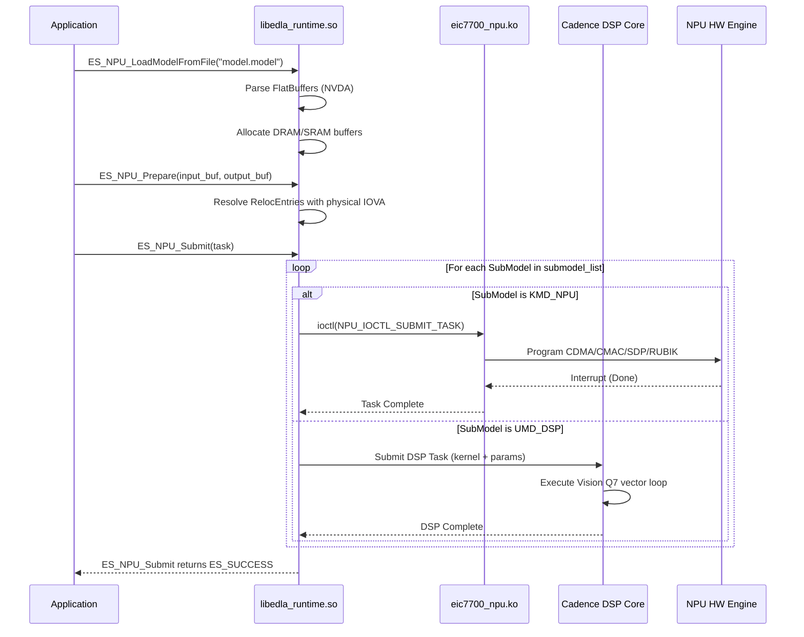

# ESWIN EIC7700X `.model` Loadable Format Specification

## 1. Overview & Binary Container

The `.model` offline loadable is the compilation artifact generated by `EsAAC` and consumed by both `EsSimulator` and `libedla_runtime.so`. 

- **Container Technology**: Google FlatBuffers binary serialization format.
- **Magic Identifier**: `"NVDA"` at byte offset `0x04` to `0x07` (derived from NVIDIA NVDLA `ILoadable` container format, extended by ESWIN with proprietary submodel and DSP execution records).
- **Byte Order**: Little-Endian (LSB first), 32-bit offset pointers.

### Header Layout
```
Offset  Size (bytes)   Description
0x00    4              Offset to Root Table (FlatBuffers uoffset_t)
0x04    4              File Identifier: ASCII "NVDA" (0x4E 0x56 0x44 0x41)
0x08    ...            FlatBuffers vtables, tables, vectors, and raw binary blobs
```

---

## 2. FlatBuffers Schema Decomposition (Reverse-Engineered)

From DWARF debug information in `rootfs-esssim/home/eswin/EsAAC`, `rootfs-esssim/home/eswin/EsSimulator`, and demangled symbols in `libedla_runtime.so.1.0`, the logical schema is structured as follows:

### 2.1 Root Loadable Schema (`ILoadable`)
```flatbuffers
namespace eswin.priv;

enum MemoryType : byte {
    DRAM = 0,
    SRAM = 1,      // On-chip SPRAM (4MB per die)
    SYSTEM = 2     // Host-visible shared memory
}

enum ModelType : byte {
    NPU = 0,
    DSP = 1,
    GPU = 2
}

table Loadable {
    version_major: ushort;
    version_minor: ushort;
    version_patch: ushort;
    
    model_name: string;
    target_soc: string;              // e.g. "EIC7700X", "EIC7702"
    
    memory_list: [MemoryEntry];      // Memory allocation requirements
    tensor_desc_list: [TensorDesc];  // Input, output, and intermediate tensor metadata
    submodel_list: [SubModel];       // Hardware execution partitions (KMD + UMD)
    address_list: [AddressEntry];    // Symbolic address binding table
    event_list: [EventEntry];        // Synchronization primitives
    reloc_list: [RelocEntry];        // Pointer relocation patches
    blobs: [BlobEntry];              // Constant weights, biases, and LUT arrays
}
```

---

## 3. Detailed Table Specifications

### 3.1 Memory List (`MemoryEntry`)
Defines the memory buffers required to execute the model:
```flatbuffers
table MemoryEntry {
    id: uint;                        // Memory buffer ID (referenced in AddressList)
    size: ulong;                     // Required allocation size in bytes
    alignment: uint;                 // Buffer alignment requirement (typically 4096 or 2097152)
    domain: MemoryType;              // DRAM, SRAM (SPRAM), or SYSTEM
    flags: uint;                     // Read-only, read-write, persistent across runs
}
```
*Note*: During `ES_NPU_AllocTaskMemory`, the runtime allocates DMA buffers matching the total size of all DRAM entries in this list.

### 3.2 Tensor Descriptors (`TensorDesc`)
Defines network inputs and outputs exposed to userspace:
```flatbuffers
enum DataFormat : ubyte {
    UNKNOWN = 0,
    NCHW = 1,
    NHWC = 2,
    NCxHWx = 3
}

enum DataType : ubyte {
    UNKNOWN = 0,
    FLOAT32 = 1,
    HALF_FP16 = 2,
    INT16 = 3,
    INT8 = 4,
    UINT8 = 5,
    UINT16 = 6,
    INT32 = 7,
    UINT32 = 8,
    INT64 = 9,
    UINT64 = 10
}

table TensorDesc {
    name: string;                    // Tensor name matching ONNX node name
    id: uint;                        // Tensor identifier
    buffer_size: ulong;              // Byte size (aligned)
    dims: Dims4;                     // [N, C, H, W]
    data_format: DataFormat;         // NCHW
    data_type: DataType;             // FP16, INT8, etc.
    data_category: ubyte;            // 0: feature map, 1: weight, 2: bias
    pixel_format: ubyte;
    pixel_mapping: ubyte;
    strides: [uint];                 // Stride in bytes along each dimension
    address_id: uint;                // Index into AddressList
}

struct Dims4 {
    n: int;
    c: int;
    h: int;
    w: int;
}
```

### 3.3 SubModel List (`SubModel`)
The compiler partitions the neural network graph into sequential or parallel SubModels:
- **`KmdSubModel`**: Executed directly by the NPU Kernel Mode Driver (KMD). Contains packed NVDLA register programming sequences for CDMA, CSC, CMAC, CACC, SDP, PDP, CDP, and RUBIK.
- **`UmdSubModel`**: Executed in Userspace / DSP firmware. Invokes a Cadence Vision Q7 DSP kernel from `dsp_kernels/`.

```flatbuffers
enum SubModelType : byte {
    KMD_NPU = 0,
    UMD_DSP = 1
}

table SubModel {
    id: uint;
    type: SubModelType;
    cost: float;                     // Estimated latency or cycle cost
    
    // For KMD_NPU submodels:
    npu_op_container: [NpuOpDesc];   // Sequence of NPU engine operations
    surface_container: [SurfaceDesc];// Memory surface base pointers
    
    // For UMD_DSP submodels:
    dsp_kernel_name: string;         // e.g. "libes_onnx_rms_normalization_f16f16.so"
    dsp_params_blob_id: uint;        // Reference to parameter struct in blobs table
    dsp_input_address_ids: [uint];   // Indices into AddressList for DSP input tensors
    dsp_output_address_ids: [uint];  // Indices into AddressList for DSP output tensors
    
    pre_events: [uint];              // Events to wait on before starting this submodel
    post_events: [uint];             // Events signaled upon completion of this submodel
}
```

### 3.4 Relocations & Address List
To enable zero-copy execution and flexible buffer allocation without recompilation:
- **`AddressList`**: An array of symbolic address slots. Inputs and outputs are assigned fixed address slots.
- **`RelocEntry`**: Instructs the runtime loader how to patch the raw NVDLA register command stream:
```flatbuffers
table RelocEntry {
    address_id: uint;                // Symbolic address ID from AddressList
    submodel_id: uint;               // Target SubModel containing the command
    command_offset: uint;            // Byte offset inside the NPU command buffer
    shift: ubyte;                    // Bit shift to apply to the physical address
    mask: ulong;                     // Bitmask for address insertion
}
```
When `ES_NPU_Prepare` binds a physical DMA buffer (or IOVA via SMMU), the runtime walks `reloc_list` and writes `(iova + offset) >> shift` directly into the command stream before issuing `NPU_IOCTL_SUBMIT_TASK`.

### 3.5 Blobs Table (`BlobEntry`)
Contains constant binary payloads embedded directly inside the `.model` file:
```flatbuffers
table BlobEntry {
    id: uint;
    size: ulong;
    data: [ubyte];                   // Raw IEEE 754 FP16 weights, INT8 weights, or LUT arrays
}
```

---

## 4. Submodel Execution Flow in Runtime



---

## 5. Reverse-Engineering Verification Commands

The validity of the FlatBuffers container can be verified on any `.model` file using Python:
```python
with open("test.model", "rb") as f:
    header = f.read(8)
    root_offset = int.from_bytes(header[0:4], "little")
    magic = header[4:8].decode("ascii", errors="replace")
    print(f"Root Table Offset: {root_offset}, Magic: '{magic}'")
    assert magic == "NVDA", "Invalid loadable file magic!"
```
All models generated by `EsAAC` in `artifacts/` (`test_conv_npu_b1.model`, `test_swiglu_mlp_npu_b1.model`, `smollm_lm_head_d0_npu_b1.model`) adhere strictly to this specification.
