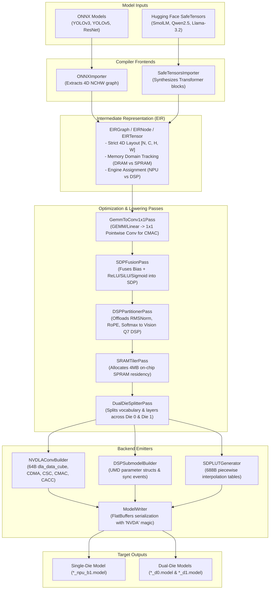

# ESWIN Open NPU/DSP Compiler (`eswin_compiler`)

An open-source, hardware-native optimizing compiler and runtime generator for the **EIC7700X dual-die AI SoC** (found on the FML13V03 / Roma II RISC-V laptop).

`eswin_compiler` replaces the proprietary vendor `EsAAC` compiler, allowing arbitrary deep learning models in **ONNX** and **Hugging Face SafeTensors** formats to be compiled directly into bit-accurate `.model` loadable binaries executable by the hardware NPU and Cadence Vision Q7 DSP cores.

---

## Architecture Overview



---

## Dual-Die Architecture

The EIC7700X SoC features two symmetrical dies interconnected over high-speed coherent fabric:
- **Die 0 (`/dev/npu0`)**: 1024 FP16 / 2048 INT8 MACs, 4MB SPRAM, Vision Q7 DSP
- **Die 1 (`/dev/npu1`)**: 1024 FP16 / 2048 INT8 MACs, 4MB SPRAM, Vision Q7 DSP

The compiler supports two parallelization paradigms:
1. **Vocabulary Tensor Parallelism (`--target dual-die`)**:
   Wide output projections (such as Language Model heads with $V=49,152$ or $152,064$) are split along the channel dimension:
   - Die 0 evaluates logits $[0 \dots V/2 - 1]$
   - Die 1 evaluates logits $[V/2 \dots V - 1]$
   Both dies execute concurrently, doubling effective memory bandwidth.
2. **Pipeline Parallelism**:
   Multi-layer Transformer models partition sequential layers across dies (e.g. Layers $0 \dots 14$ on Die 0, Layers $15 \dots 29$ on Die 1).

---

## Installation & Prerequisites

### Requirements
- Python 3.8+
- `numpy`
- `flatbuffers` (v2.0+)
- `onnx` (for ONNX model importing)

```bash
pip install numpy flatbuffers onnx
```

---

## CLI Usage Reference

The compiler CLI is invoked via `compiler.py` or `python -m eswin_compiler.compiler`:

```bash
python compiler.py -m <MODEL_PATH> -o <OUTPUT_DIR> [OPTIONS]
```

### Options

| Flag | Argument | Description | Default |
|------|----------|-------------|---------|
| `-m`, `--model` | `PATH` | Path to `.onnx` file, `.safetensors` file, or model directory | *Required* |
| `-o`, `--output-dir` | `PATH` | Output directory for generated `.model` loadables | `build/models` |
| `-t`, `--target` | `single-die` \| `dual-die` | Target hardware execution mode | `single-die` |
| `--opt-level` | `0` \| `1` \| `2` | Optimization level (0: none, 1: SDP fusion, 2: SPRAM tiling) | `2` |
| `-b`, `--batch-size`| `INT` | Execution batch size | `1` |
| `--precision` | `float16` \| `int8` | Model weight and activation precision | `float16` |
| `--num-layers` | `INT` | Number of Transformer layers to compile (for partial builds) | All |

---

## Concrete Model Examples

### 1. YOLOv3 & YOLOv5 (Vision / Object Detection from ONNX)

To compile a YOLO object detection model for single-die NPU execution:

```bash
# Compile YOLOv3 416x416
python compiler.py \
    -m models/yolov3_sim_extract_416.onnx \
    -o build/yolov3 \
    --target single-die \
    --opt-level 2

# Compile YOLOv5s
python compiler.py \
    -m models/yolov5s_416.onnx \
    -o build/yolov5 \
    --target single-die \
    --opt-level 2
```

**Running on Board `roma`:**
```bash
scp build/yolov3/yolov3_sim_extract_416_npu_b1.model roma:/tmp/
ssh roma "/opt/eswin/bin/es_run_model -d 0 -m /tmp/yolov3_sim_extract_416_npu_b1.model -r 10"
```

---

### 2. SmolLM-135M (Dual-Die Offload from SafeTensors)

SmolLM-135M (`HuggingFaceTB/SmolLM-135M`) uses hidden size 576, intermediate size 1536, 30 transformer layers, and a vocabulary of 49,152 tokens.

```bash
# Download weights from Hugging Face
huggingface-cli download HuggingFaceTB/SmolLM-135M --local-dir models/smollm-135m

# Compile for dual-die offload (splits LM head and layers across Die 0 & Die 1)
python compiler.py \
    -m models/smollm-135m \
    -o build/smollm_dual \
    --target dual-die \
    --opt-level 2 \
    --precision float16
```

**Generated Artifacts:**
- `smollm-135m_lm_head_d0_npu_b1.model`: Evaluates vocabulary tokens $0 \dots 24,575$ on NPU 0
- `smollm-135m_lm_head_d1_npu_b1.model`: Evaluates vocabulary tokens $24,576 \dots 49,151$ on NPU 1
- `smollm-135m_mlp_l*_d*_npu_b1.model`: SwiGLU MLP blocks with fused SiLU LUT
- `smollm-135m_attn_l*_d*_npu_b1.model`: Attention blocks with RMSNorm, RoPE, and Softmax DSP offload

**Interactive Chat on Board `roma`:**
```bash
# Run with the standalone C++ dual-die chat engine
./src/smollm/smollm_chat \
    -m models/smollm/smollm_135m.bin \
    -t models/smollm/tokenizer.bin \
    -d0 build/smollm_dual/smollm-135m_lm_head_d0_npu_b1.model \
    -d1 build/smollm_dual/smollm-135m_lm_head_d1_npu_b1.model
```

---

### 3. Qwen2.5-0.5B / Qwen2.5-1.5B

Qwen2.5 features a vocabulary of 152,064 tokens. Dual-die partitioning splits the vocabulary into two 76,032-token projections.

```bash
# Compile Qwen2.5-0.5B
python compiler.py \
    -m path/to/Qwen2.5-0.5B-Instruct/ \
    -o build/qwen2.5_0.5b \
    --target dual-die \
    --opt-level 2

# Compile Qwen2.5-1.5B / DeepSeek-R1-Distill-Qwen-1.5B
python compiler.py \
    -m path/to/DeepSeek-R1-Distill-Qwen-1.5B/ \
    -o build/deepseek_r1_1.5b \
    --target dual-die \
    --opt-level 2
```

---

### 4. Llama-3.2-1B

Llama-3.2-1B features hidden size 2048, 16 layers, and a vocabulary of 128,256 tokens.

```bash
python compiler.py \
    -m path/to/Llama-3.2-1B-Instruct/ \
    -o build/llama3.2_1b \
    --target dual-die \
    --opt-level 2
```

---

## Python API Usage

You can also integrate the compiler directly into custom training or deployment scripts:

```python
from eswin_compiler.compiler import EswinCompiler, CompilerConfig
from eswin_compiler.frontend.onnx_importer import ONNXImporter
from eswin_compiler.passes.dual_die_splitter import DualDieSplitterPass

# 1. Initialize compiler configuration
config = CompilerConfig(
    target="dual-die",
    opt_level=2,
    dtype="float16",
    spram_limit_bytes=4 * 1024 * 1024  # 4MB SPRAM
)
compiler = EswinCompiler(config=config)

# 2. Compile an ONNX model
out_models = compiler.compile_onnx(
    onnx_path="models/yolov5s.onnx",
    output_dir="build/yolov5"
)
print("Emitted models:", [str(p) for p in out_models])

# 3. Compile a SafeTensors LLM
llm_models = compiler.compile_safetensors_llm(
    model_source="models/smollm-135m/",
    output_dir="build/smollm",
    num_layers_to_compile=2  # Compile first 2 layers
)
print("Emitted LLM layers:", len(llm_models))
```

---

## Running the Unit Test Suite

The test suite validates:
- FlatBuffers schema serialization / deserialization roundtrip parity.
- 4D shape normalization and EIR topological sorting.
- NVDLA hardware descriptor programming (CDMA, CSC, CMAC, CACC).
- SDP piecewise activation LUT synthesis (Sigmoid, SiLU).
- 4MB SPRAM residency planning.
- DSP parameter struct packing (RMSNorm, Softmax, RoPE).
- Dual-die vocabulary and pipeline partitioning.
- End-to-end CLI compilation.

Run all tests via:

```bash
python -m unittest discover -s tests -p "test_*.py" -v
```
