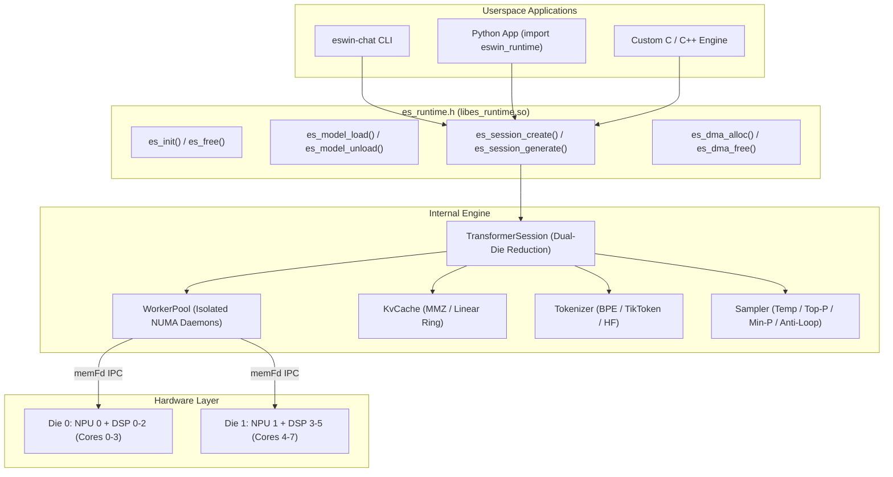

# Open ESWIN Runtime: High-Level C11 API & Python Bindings Guide

## 1. Overview

The **Open ESWIN Runtime** (`eswin_runtime`) provides a unified, cross-platform architecture for accelerating deep learning and autoregressive LLM inference across the EIC7700X dual-die NPU and Cadence Vision Q7 DSP cores.

It delivers:
1. **Public C11 ABI** (`include/es_runtime.h`): Strictly C11-compliant linkable shared library (`libes_runtime.so`) without C++ runtime leakage or external dependencies.
2. **Interactive Streaming Chat CLI** (`eswin-chat`): Production-ready terminal chat REPL with ANSI colors, live token streaming, prompt evaluation & token/s telemetry, and graceful `SIGINT` interruption.
3. **Pythonic ctypes SDK** (`python/eswin_runtime`): Idiomatic Python bindings with RAII context managers (`RuntimeContext`, `Model`, `Session`, `DmaBuffer`).

---

## 2. High-Level C11 ABI Architecture



---

## 3. C11 API Reference

### 3.1 Model Management

```c
typedef struct {
    const char       *model_path;     /* Directory with manifest.json or path to .model */
    const char       *tokenizer_path; /* Path to tokenizer.json / vocab file */
    const char       *cache_dir;      /* Cache path (default: ~/.cache/eswin/models) */
    es_device_mode_t  device_mode;    /* ES_DEVICE_DUAL_DIE_AUTO, DIE0, or DIE1 */
} es_model_config_t;

es_status_t es_model_load(es_context_t *ctx, const es_model_config_t *config, es_model_t **out_model);
void        es_model_unload(es_model_t *model);
es_status_t es_model_get_info(const es_model_t *model, es_model_info_t *info);
```

### 3.2 Session & Autoregressive Generation

```c
typedef struct {
    size_t              max_seq_len;     /* Context window (e.g. 2048) */
    int32_t             max_new_tokens;  /* Max tokens per turn (e.g. 512) */
    bool                enable_dual_die; /* Concurrent dual-die execution */
    es_sampler_params_t sampler_params;  /* Temp, top-k, top-p, repeat penalty */
} es_session_config_t;

typedef bool (*es_token_callback_t)(int32_t token, const char *piece, void *user_data);

es_status_t es_session_create(es_model_t *model, const es_session_config_t *config, es_session_t **out_session);
es_status_t es_session_generate(
    es_session_t *session,
    const char *prompt,
    es_token_callback_t callback,
    void *user_data,
    es_perf_stats_t *stats
);
es_status_t es_session_reset(es_session_t *session);
void        es_session_free(es_session_t *session);
```

---

## 4. Interactive Chat CLI (`eswin-chat`)

The `eswin-chat` executable provides a plug-and-play CLI to interact with any supported model package:

```bash
# Build
make

# Run interactive session
./build/eswin-chat --model path/to/model_dir --temp 0.7 --top-p 0.9 --max-tokens 512
```

### Interactive Commands
- `/reset`: Clears conversation history and flushes KV-cache.
- `/stats`: Displays execution latency and throughput telemetry.
- `/info`: Displays model parameters, vocabulary size, and active die mode.
- `/help`: Lists supported commands.
- `Ctrl+C`: Halts streaming token generation without terminating the REPL.

---

## 5. Python SDK Usage

Install or import directly from `python/eswin_runtime`:

```python
import sys
sys.path.insert(0, "python")
from eswin_runtime import RuntimeContext, SamplerParams, DeviceMode

# 1. Initialize context with RAII
with RuntimeContext() as ctx:
    print(f"Detected NPU dies: {ctx.device_count}")

    # 2. Load model package
    with ctx.load_model("models/smollm_135m", device_mode=DeviceMode.DUAL_DIE_AUTO) as model:
        print(f"Loaded: {model.info.name} ({model.info.architecture})")

        # 3. Create inference session
        params = SamplerParams(temperature=0.7, top_p=0.9, repeat_penalty=1.15)
        with model.create_session(max_new_tokens=256, sampler_params=params) as session:
            # 4. Stream response
            def token_stream(token_id, piece):
                print(piece, end="", flush=True)
                return True

            prompt = "What are the advantages of RISC-V computing?"
            print(f"Prompt: {prompt}\nResponse: ", end="")
            session.generate(prompt, callback=token_stream)
            print()

            stats = session.last_stats
            print(f"Performance: {stats.tokens_per_sec:.2f} tokens/s")
```
